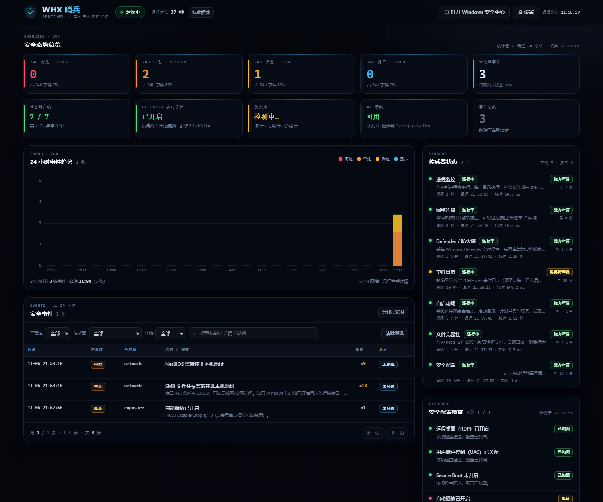

# WHX Sentinel

**A local-only host monitoring agent for Windows · local security dashboard**

> 中文文档：[README.md](README.md)

WHX Sentinel is a lightweight, single-process host monitoring agent for Windows 10/11.
It watches what is happening on your machine — processes, network connections,
autoruns, Windows event logs, Defender/firewall status, file integrity and security
posture — turns rule hits into local events, and shows them in a dashboard served
from `http://127.0.0.1:8765/`.

Everything stays on the local machine: **no cloud, no telemetry, no agent-server.**

> ⚠️ This is a **visibility tool**, not an antivirus and not an enterprise EDR.
> It does not stop attacks; it tries to make them visible. Please read
> [Capability boundaries](#capability-boundaries) before use.

---

## Features

- **8 sensors** covering processes, network connections, Defender/firewall state,
  Windows event logs, autoruns/persistence, file integrity and security posture.
- **Rule engine** with severity levels, allow-listing, de-duplication and baselines
  (objects that existed before startup do not raise alerts).
- **Local dashboard**: 24h severities, event timeline, filterable event list,
  sensor health, security posture checks, recent response actions, host/database info.
- **Optional desktop notifications** for HIGH-and-above events.
- **Optional AI triage** using a local Ollama instance (never a remote API).
- **Optional response actions** (Defender quick scan, signature update, firewall
  block/unblock, kill process) — always manual by default; the two auto-response
  switches ship **disabled**.
- **Self-contained**: plain Python, no installer, no registry writes except the
  optional per-user autostart entry.

## Sensor matrix

| Sensor | Interval | What it watches |
| --- | --- | --- |
| `process` | 2 s | Suspicious command lines (encoded/hidden PowerShell, download-and-execute, IEX, certutil/bitsadmin/mshta/regsvr32/rundll32/wmic, …), execution from temp dirs, Office spawning shells, scheduled-task creation, account operations, shadow-copy deletion, log clearing, Defender/firewall tampering, credential theft, hacking/RAT tools, UAC-bypass components |
| `network` | 4 s | New listening ports, high-risk listeners (RDP/SMB/WinRM/databases), suspicious outbound ports (reverse shell/C2/mining/proxy), blacklisted remote IPs (`data/blocklist.txt`) |
| `defender` | 60 s | Defender service/antivirus/real-time/behavior-monitoring state, signature age, firewall profile state |
| `eventlog` | 30 s | Service installation (7045), service start-type change (7040), log clearing (104/1102), account creation/admin-group changes (4720/4728/4732), logon brute force (4625), Defender detections/config changes (1116/1117/5001/5007/5010). Security log needs admin |
| `autorun` | 300 s | HKCU/HKLM Run keys, Startup folders, scheduled tasks, services — new/modified items plus suspicious commands |
| `fileguard` | 60 s | `hosts` tampering, ransomware canary files under `%USERPROFILE%\Documents\WHX-Sentinel-Canary\`, new Defender exclusions, Startup folder changes |
| `exposure` | 1800 s | RDP enabled, SMBv1 enabled, UAC disabled, Secure Boot, AutoPlay |

## Screenshot



## Quick start

**Requirements**

| Item | Requirement |
| --- | --- |
| OS | Windows 10/11 (PowerShell 5.1+, built in) |
| Python | 3.12 (3.10+ usually works; 3.12 is the tested target) |
| Runtime deps | `fastapi`, `uvicorn`, `httpx`, `psutil` |
| Optional | Node.js (only for the front-end syntax check in tests) |
| Optional | Local Ollama (AI triage, default model `deepseek-r1:8b`) |

```bat
git clone <this-repo> whx-sentinel
cd whx-sentinel
python -m pip install -r requirements.txt

:: start in the background and open the dashboard
install\start_sentinel.bat

:: or run in the foreground (logs visible in the console)
python sentinel.py --open
```

Then open <http://127.0.0.1:8765/>.

The first run creates `data/` with `config.json` (including a random control token),
`sentinel.db` (WAL mode) and `logs/`.

## Command line

```
python sentinel.py [--data-dir DIR] [--port PORT] [--open] [--daemon]
                   [--once] [--status] [--stop] [--smoke-test]
                   [--install-autostart] [--uninstall-autostart] [--version]
```

| Command | Purpose |
| --- | --- |
| `install\start_sentinel.bat` | Background start (pythonw, no console) + open dashboard |
| `python sentinel.py --open` | Foreground start, auto-open browser |
| `install\start_elevated.bat` | Start elevated (one UAC prompt) to unlock Security event log + Defender/firewall actions |
| `python sentinel.py --status` | Uptime, sensor states, 24h stats, Defender/AI status |
| `python sentinel.py --stop` | Graceful stop (PID fallback) |
| `python sentinel.py --once` | Run one collection round, print findings, no service, no DB writes |
| `python sentinel.py --smoke-test` | Run the side-effect-free smoke test suite |

Exit codes: `0` success, `1` failure/not running, `2` smoke test file missing.

## Standard vs. elevated mode

| Capability | Standard (double-click) | Elevated (`start_elevated.bat`) |
| --- | --- | --- |
| Process / network / autorun / file-integrity monitoring | ✅ | ✅ |
| Defender state read | ✅ (usually readable) | ✅ |
| Security event log read | ❌ (`needs_admin`) | ✅ |
| Firewall block/unblock | ❌ | ✅ |
| Defender scan / signature update | ❌ | ✅ |
| Kill other users' processes | ❌ | ✅ |

Both modes share the same data directory. Standard mode is enough for day-to-day use.

## Data & privacy

All data lives in `<install dir>\data\` (override with `--data-dir`):

| File | Content |
| --- | --- |
| `sentinel.db` | SQLite event store (events, actions, metadata), WAL mode |
| `config.json` | Local control token, settings, allow-list |
| `logs/sentinel.log` | Rolling log (~2 MB × 3) |
| `baselines.json` | Autorun / listener / file-integrity / Defender-exclusion baselines |
| `blocklist.txt` | Optional manual IP/CIDR blocklist |

Retention defaults: **30 days / 20 000 events**, pruned hourly, configurable.
The agent listens only on `127.0.0.1`, never sends data anywhere, never scans
external hosts, and AI triage only ever talks to a loopback Ollama endpoint
(`http://127.0.0.1:11434`; `ollama_url` is parsed and restricted to loopback hosts
plus port 11434). AI triage is **off by default**. To delete everything, stop the
agent and remove `data/` (plus `%USERPROFILE%\Documents\WHX-Sentinel-Canary\` if
canary files were created).

A per-install random `internal_marker` is generated on first run and kept out of the
public settings API; it is only used to ignore the agent's own PowerShell probes.

## Security model

- Dashboard binds to `127.0.0.1` only. It is intentionally unreachable from the LAN.
- **Every HTTP endpoint (read-only included) validates the `Host` header** and only
  accepts `127.0.0.1` / `localhost` / `[::1]`, which blocks DNS-rebinding pages from
  reading events or settings.
- A random `control_token` is generated on first run. Every write API requires the
  `X-Sentinel-Token` header; comparisons are constant-time. The token is only
  returned to loopback clients.
- The control token protects against **browser cross-origin requests only**. It does
  **not** protect against local processes: any process or user on the same machine can
  read `data/config.json` or call `/api/token`, then change settings, add allow-list
  entries (silencing alerts) or stop the agent. The tool assumes a **single-user
  workstation**; do not run it on shared/multi-user machines.
- The dashboard ships a strict CSP, no inline scripts and no external resources;
  event/process data is rendered as text.
- Response actions are manual by default. The two automatic actions
  (`auto_quick_scan_on_malware`, `auto_block_high_remote`) are **off** by default.
- Critical system processes are always refused by the kill-process action (PID 0/4 are
  rejected as well).

**Known limitation:** there is no kernel driver and no tamper protection. Malware
running as an administrator can stop or bypass the agent. Protecting against
same-user local processes is *not* a goal of this project.

## Capability boundaries

1. **Not an antivirus.** No file scanning, no memory/no-file attack detection, no
   cloud reputation. It reads and displays Defender state; keep Defender enabled.
2. **Monitor and alert only by default.** Firewall blocks, Defender scans and
   process kills all require an explicit click on the dashboard.
3. **Startup baseline.** Objects that already existed before the agent started do
   not raise alerts; a machine compromised earlier will not be retro-detected.
4. **No kernel driver, no self-protection** (see above).
5. **Rules can produce false positives and false negatives.** Legitimate dev tools
   spawn PowerShell too; use the allow-list and combine with Defender/context.
6. **Standard mode is limited** (Security log, firewall, Defender actions need admin).
7. **Single host, local only.** No server, no alert forwarding, no multi-user
   management — not an enterprise EDR or compliance audit product.
8. **Response actions may fail** for policy / security-software / privilege reasons;
   failures are recorded under "recent actions".
9. **The control token is not a local-process boundary.** It only stops browser
   cross-origin reads/writes. Any same-machine process can read `data/config.json` or
   call `/api/token` and then mute or stop the agent; this project assumes a
   single-user workstation.
10. **The internal probe marker is random per install.** It is generated on first run
    and only used to skip the agent's own probe subprocesses; no fixed bypass string is
    shipped in the public source.

## Testing

```bat
python tests\smoke_test.py
```

The suite runs 75 checks with no side effects (no service, no sensors, no toast,
no Defender scan, no firewall/registry changes; temporary data goes to
`_smoke_data/` and is always removed). GitHub Actions runs it on `windows-latest`
with Python 3.12 — see `.github/workflows/ci.yml`.

## Project layout

```
whx-sentinel/
├─ sentinel.py        # CLI entry point
├─ config.py          # paths, defaults, token generation, config I/O
├─ core.py            # application core: config/db/sensors/analyst/state
├─ db.py              # SQLite event store
├─ rules.py           # rule matchers
├─ rules_data.py      # built-in rules (process/ports/eventlog/posture)
├─ analyst.py         # allow-list → dedupe → store → toast/AI/auto-response
├─ respond.py         # notifications and response actions
├─ ai.py              # optional local Ollama triage
├─ winutil.py         # Windows helpers (PowerShell probes, registry, hashes)
├─ events.py          # Finding model and severity helpers
├─ webapi.py          # FastAPI app: read APIs + token-protected write APIs
├─ sensors/           # 8 sensors, one file each
├─ web/               # local dashboard (no external resources, CSP)
├─ install/           # start/stop/autostart/uninstall .bat scripts
├─ tests/             # side-effect-free smoke tests
└─ docs/              # screenshots
```

## License

[MIT](LICENSE). Third-party dependencies keep their own licenses
(FastAPI, uvicorn, httpx, psutil).

## Disclaimer

This project is meant for local security visibility, personal protection and
learning. It is **not** a professional security product, and it is not a substitute
for Windows Defender or a compliance tool. Use at your own risk.
